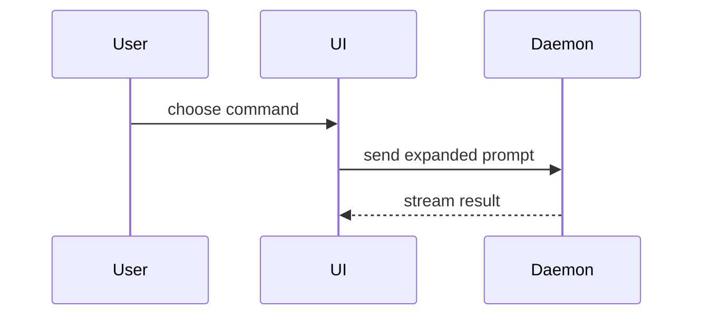

写 PR 正文时使用这个模板：

```markdown
## Summary

<diagram, diff-sketch, or tree>

## Evidence

- **Before:** <screenshot/output/failing test run>
  **After:** <screenshot/output/passing test run>

## Merge Danger

**Door:** <one-way or two-way>

<optional: description>

**Blast Radius:** <one-word description>

<optional: potential ramifications of merge>
```

## 各节

跳过所有前言，正文保持简短。使用用户在 `GLOSSARY.md` 里的领域语言。

### 摘要

挑一个能让要点清楚的最小视图。

- 用伪代码展示逻辑或算法：

```text
on(save)
  if content is unchanged
    return cached result
  write new content
  return fresh result
```

- 用调用树展示运行时控制流：

```text
submitForm
  createSession
    persistPrompt
    launchAgent
  navigateToSession
```

- 用组件树展示 UI 结构，包括重要的状态和模块边界：

```text
<SessionPage> (apps/example/src/routes/session.tsx)
  useSessionEvents()
  <SessionToolbar>
    <RunSkillButton> (packages/ui)
```

- 用浅层文件树展示文件职责或大范围重构：

```text
src/
├── commands/       # 解析用户动作
├── sessions/       # 持有会话状态
└── transport/      # 发送 API 请求
```

- 用 Mermaid 展示组件交互、控制流或数据流：



- 当要点是“什么变了”、而周围形状已经存在时，用 `diff`。让 diff 的形状匹配主题。

组件变更：

```diff
 <SessionPage>
   useSessionEvents()
   <SessionToolbar>
+    <RunSkillButton />
   <SessionTimeline>
+    <SkillResultCard />
```

文件布局变更：

```diff
 src/
 ├── commands/
+│   └── show-me.ts       # 展开 slash 命令
 ├── sessions/
-└── transport.ts
+└── transport/
+    ├── client.ts
+    └── stream.ts
```

调用树或调用栈变更：

```diff
 submitForm
   createSession
     persistPrompt
+    expandSkillMention
     launchAgent
-  navigateToSession
+  navigateToSession
+    subscribeToEvents
```

状态或控制流变更：

```diff
 on(save)
-  write content
+  if content is unchanged
+    return cached result
+  write new content
+  invalidate cache
```

- 当大部分内容都是新的、省略上下文会掩盖归属或顺序，或者用户需要一个可复制的目标形状时，展示整个代码块：

```ts
function expandSkill(command: string): string {
  const skillName = command.slice(1);
  return `use the ${skillName} skill`;
}
```

#### 指导

把每个可视化放在它所支撑的短文字旁边。只保留回答用户当前问题、或说明当前讨论点待解决选项所需的调用、文件、props、状态和边界。

你可以用其中一种，也可以用几种，但不太可能全都用上。自行判断，别让用户不堪重负。

### 证据

改动有效的具体证据。展示改动前和改动后的对比。

截图是 S 级——前提是环境已经支持，而且改动是视觉上的。

基于执行的证据是 A 级。测试结果、控制台输出。用伪代码展示现在失败、改后通过的那个具体测试。

### 合并风险

说明这是一扇单向门还是双向门。双向门可以走回去，单向门不行。回滚代价低的 PR 风险更低。涉及破坏性操作或难以撤销的决策的改动，就是单向门。

影响范围（blast radius）是这个 PR 引入的改动可能造成的影响或波及面。把所有可能性都考虑进来。例子包括布局位移、对使用方的破坏、移动端响应式等。